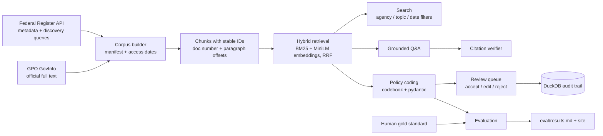

# Policy Surveillance AI Lab

**Responsible, evaluable AI for public health policy surveillance.** Search public Federal Register documents on nutrition, physical activity, and obesity prevention. Ask questions answered only from the documents you select, with a citation on every sentence. Code documents against a structured policy codebook, keep a human in the loop for every code, and measure AI-vs-human agreement.

> **Independent portfolio project. Not affiliated with, endorsed by, or produced for the CDC or any government agency. Uses only public-domain documents. AI outputs require human review.**

[](https://github.com/saikurmana/policy-surveillance-ai-lab/actions/workflows/ci.yml)
Project site: https://saikurmana.github.io/policy-surveillance-ai-lab/ (published by the Pages workflow) · Live app: https://policy-ai-lab.streamlit.app/ (demo mode by default)

## The problem

Policy surveillance means reading laws and regulations and turning them into structured data: which settings a rule covers, whether it is binding, which nutrients it limits, when it takes effect. Teams do this by hand. Federal rules on school meals, WIC food packages, or food labeling often run 80 to 250 printed pages, so manual review is **slow**. Two trained coders can also read the same rule and disagree, so it is **inconsistent**. Generative AI could help, but an answer without traceable evidence cannot be used in public health practice, and an AI code nobody has measured cannot be trusted.

## What this project demonstrates

| Capability | How it is done here |
|---|---|
| **Real, documented corpus** | 61 Federal Register documents collected through the official API, with full text from GPO GovInfo. Each has its provenance and access date in [`data/corpus_manifest.csv`](data/corpus_manifest.csv). |
| **Grounded answers** | The model sees only passages retrieved from documents the user selects. Every sentence must cite a chunk ID. A verifier flags uncited sentences, invented chunk IDs, low overlap, and numbers that do not appear in the source. If evidence is insufficient, the system says so. |
| **Structured coding** | An 11-variable [YAML codebook](codebook/policy_codebook.yaml). For each variable the model returns values, an exact quote, the chunk ID, and a confidence score, all validated by pydantic and checked against the codebook. |
| **Human in the loop** | A review queue where a reviewer accepts, edits, or rejects each code, with a reason. Decisions go to an append-only DuckDB audit trail with reviewer ID, timestamp, time spent, model, served model, prompt version, and codebook version. |
| **Rigorous evaluation** | Per-variable accuracy and Cohen's kappa, quote verification, citation precision, abstention rates, and retrieval recall@k. The [protocol](docs/evaluation_protocol.md) explains how to build the human gold standard and read the results. |
| **Governance** | [Responsible use](docs/responsible_use.md), [model card](docs/model_card.md), [data governance](docs/data_governance.md), and [evaluation protocol](docs/evaluation_protocol.md), written as templates another health agency could adapt. |
| **Swappable, keyless by default** | Claude runs behind a provider interface. The app runs in a clearly labeled demo mode with an offline baseline unless an operator configures a key and the viewer enters the live mode password. CI uses that baseline and needs no secrets. |

A useful analogy: the AI here works like a research assistant who hands you sticky-noted pages. Every claim points to the exact paragraph it came from. You still decide what goes in the report, and the notebook records who signed off.

## Architecture



| Path | What lives there |
|---|---|
| `corpus/topics.yaml` | Topic queries, inclusion/exclusion criteria, curated document list |
| `policylab/` | Library: corpus builder, chunker, retrieval, LLM providers, Q&A, verifier, coding, DuckDB, evaluation, site builder |
| `policylab/prompts/` | Versioned prompts (`qa_v1`, `coding_v1`) |
| `codebook/policy_codebook.yaml` | The policy codebook |
| `app/streamlit_app.py` | Streamlit app (Search, Ask, Code, Review, Audit trail, Evaluation, Corpus) |
| `data/` | Manifest, query log, committed snapshot (2.3 MB), demo outputs |
| `eval/` | Gold-standard files, results, charts |
| `docs/` | Governance templates |
| `site/` | Static site templates for GitHub Pages |

## Quickstart (demo mode, no API key)

Requires Python 3.11+.

```bash
pip install -r requirements-dev.txt && pip install -e . --no-deps
```

```bash
make test
```

```bash
make app
```

The app opens with the committed corpus snapshot. Search works fully. Without hybrid embeddings it uses BM25 and says so in the sidebar. Ask and Code use the offline keyword/extractive baseline, and every output is labeled as not coming from an LLM.

Optional extras:

```bash
make install-ml && make index   # local embedding model (CPU) for hybrid search
make eval                       # regenerate eval/results.md and charts
make site                       # build the GitHub Pages site into _site/
make corpus                     # rebuild the corpus from the live APIs
```

## Enabling live AI with your own key

The app stays in demo mode by default, including on a public deployment. Live LLM mode turns on only when **both** conditions hold:

1. `ANTHROPIC_API_KEY` and `LIVE_MODE_PASSWORD` are set, in the environment or in Streamlit secrets.
2. The viewer types the `LIVE_MODE_PASSWORD` value into the **Live mode password** box in the sidebar.

A key without a password secret never enables live mode, so visitors to a public app cannot spend your API budget. Think of the key as the car and the password as the ignition key: having the car parked outside does not let a passer-by drive it. Keys and passwords are never stored in this repository.

```bash
export ANTHROPIC_API_KEY=...        # your own key
export LIVE_MODE_PASSWORD=...       # any long random string
make app                            # then enter the password in the sidebar
```

Locally you can put both in `.streamlit/secrets.toml` (git-ignored; see [`.streamlit/secrets.toml.example`](.streamlit/secrets.toml.example)).

Defaults: model `claude-sonnet-5-5`, effort `medium`, structured outputs validated by pydantic, server-side refusal fallback enabled (the model that actually answered is recorded as `served_model`). Override with the `POLICYLAB_MODEL` and `POLICYLAB_EFFORT` environment variables or secrets, for example `POLICYLAB_MODEL=claude-opus-5-5`. The evaluation CLI does not need the password; it uses the key directly:

```bash
python -m policylab.evaluation --provider anthropic
```

## Deploying to Streamlit Community Cloud

The app is deployed at **https://policy-ai-lab.streamlit.app/**. To deploy your own copy, use these settings:

| Setting | Value |
|---|---|
| Repository / branch | `saikurmana/policy-surveillance-ai-lab`, `main` |
| Main file path | `app/streamlit_app.py` |
| Python version (Advanced settings) | 3.11 |
| Dependencies | `requirements.txt` at the repository root (installed automatically) |

`requirements.txt` deliberately leaves out `torch` and `sentence-transformers`. Without them the app uses BM25 keyword search and says so in the sidebar; everything else works the same. That keeps the deploy small and fast to start. Hybrid search needs `make install-ml && make index`, which is meant for local use.

To allow live mode on the deployed app, paste into **Settings → Secrets**:

```toml
ANTHROPIC_API_KEY = "..."
LIVE_MODE_PASSWORD = "..."
# POLICYLAB_MODEL = "claude-sonnet-5-5"   # optional override
```

Leave the secrets empty for a demo-only deployment. The review queue writes to a local DuckDB file, which Streamlit Cloud resets when the app restarts, so treat the hosted audit trail as a demo.

## Corpus

61 documents, 5,094 citable chunks, built on 2026-11-05. Metadata comes from the [Federal Register API](https://www.federalregister.gov/developers/documentation/api/v1). Full text comes from [GPO GovInfo](https://www.govinfo.gov/app/collection/fr), because FederalRegister.gov asks automated clients to use its API rather than its full-text pages, and this project respects that. U.S. federal government works are public domain (17 U.S.C. 105). Every topic query returned documents, and every curated document was returned by its topic's query (see [`data/corpus_queries.json`](data/corpus_queries.json)). Selection criteria are in [`corpus/topics.yaml`](corpus/topics.yaml).

Topics overlap: a document can belong to more than one, so topic counts sum to more than 61.

> **Note on physical activity.** Most physical activity documents are Federal Register **notices**, not binding rules: 7 of the 9 are notices (comment solicitations for the Physical Activity Guidelines, Youth Sports Strategy announcements, a charter renewal) and 2 are presidential documents (a proclamation and an executive order). None is a final or proposed rule. Federal physical activity policy mostly lives in guidelines and programs rather than regulations, so most of these documents code as `not_applicable` or `voluntary` for `legal_force` (the executive order, which binds agencies but not the public, is an open gold-standard TODO). The binding rules in this corpus come from the nutrition topics, plus one final and one proposed rule under active transportation.

| Topic | Docs |
|---|---:|
| Physical activity guidelines and youth sports | 9 |
| School meal nutrition standards | 9 |
| Nutrition Facts, front-of-package, and "healthy" claims | 6 |
| Sodium reduction and food reformulation | 6 |
| Menu and vending calorie labeling | 5 |
| Active transportation (walking and bicycling) | 5 |
| WIC food packages | 4 |
| Obesity and chronic disease prevention programs | 4 |
| SNAP food environment, incentives, and nutrition education | 4 |
| Competitive foods and school wellness policies | 3 |
| Child care (CACFP) meal patterns | 3 |
| Dietary Guidelines for Americans process | 3 |

| Agency (as named by the Federal Register) | Docs |
|---|---:|
| Food and Nutrition Service | 19 |
| Food and Drug Administration | 17 |
| Health and Human Services Department | 12 |
| Food and Nutrition Administration | 4 |
| Federal Highway Administration | 3 |
| Centers for Disease Control and Prevention | 2 |
| Executive Office of the President | 2 |
| Transportation Department | 1 |
| National Park Service | 1 |

| Type | Docs |
|---|---:|
| Notice | 26 |
| Rule | 24 |
| Proposed Rule | 9 |
| Presidential Document | 2 |

<details><summary>All 61 documents with Federal Register citations</summary>


**School meal nutrition standards**

- Food and Nutrition Service. *Child Nutrition Programs: Flexibilities for Milk, Whole Grains, and Sodium Requirements*. 83 FR 63775 (2018-12-12). FR Doc. 2018-26762. [federalregister.gov](https://www.federalregister.gov/documents/2018/12/12/2018-26762/child-nutrition-programs-flexibilities-for-milk-whole-grains-and-sodium-requirements) - accessed 2026-11-05.
- Food and Nutrition Service. *Simplifying Meal Service and Monitoring Requirements in the National School Lunch and School Breakfast Programs*. 85 FR 4094 (2020-01-23). FR Doc. 2020-00926. [federalregister.gov](https://www.federalregister.gov/documents/2020/01/23/2020-00926/simplifying-meal-service-and-monitoring-requirements-in-the-national-school-lunch-and-school) - accessed 2026-11-05.
- Food and Nutrition Service. *Child Nutrition Programs: Rescission of Milk, Whole Grains, and Sodium Flexibilities: Notice of Vacatur*. 85 FR 74847 (2020-11-24). FR Doc. 2020-25760. [federalregister.gov](https://www.federalregister.gov/documents/2020/11/24/2020-25760/child-nutrition-programs-rescission-of-milk-whole-grains-and-sodium-flexibilities-notice-of-vacatur) - accessed 2026-11-05.
- Food and Nutrition Service. *Child Nutrition Programs: Transitional Standards for Milk, Whole Grains, and Sodium*. 87 FR 6984 (2022-02-07). FR Doc. 2022-02327. [federalregister.gov](https://www.federalregister.gov/documents/2022/02/07/2022-02327/child-nutrition-programs-transitional-standards-for-milk-whole-grains-and-sodium) - accessed 2026-11-05.
- Food and Nutrition Service. *Child Nutrition Programs: Revisions to Meal Patterns Consistent With the 2020 Dietary Guidelines for Americans*. 88 FR 8050 (2023-02-07). FR Doc. 2023-02102. [federalregister.gov](https://www.federalregister.gov/documents/2023/02/07/2023-02102/child-nutrition-programs-revisions-to-meal-patterns-consistent-with-the-2020-dietary-guidelines-for) - accessed 2026-11-05.
- Food and Nutrition Service. *Child Nutrition Programs: Meal Patterns Consistent With the 2020-2025 Dietary Guidelines for Americans*. 89 FR 31962 (2024-04-25). FR Doc. 2024-08098. [federalregister.gov](https://www.federalregister.gov/documents/2024/04/25/2024-08098/child-nutrition-programs-meal-patterns-consistent-with-the-2020-2025-dietary-guidelines-for) - accessed 2026-11-05.
- Food and Nutrition Service. *Request for Information: Grain-Based Desserts and High-Protein Yogurt Crediting in Child Nutrition Programs*. 89 FR 104965 (2024-12-26). FR Doc. 2024-30710. [federalregister.gov](https://www.federalregister.gov/documents/2024/12/26/2024-30710/request-for-information-grain-based-desserts-and-high-protein-yogurt-crediting-in-child-nutrition) - accessed 2026-11-05.
- Food and Nutrition Service. *Expanding Fluid Milk Options in Child Nutrition Programs*. 91 FR 25073 (2026-05-08). FR Doc. 2026-09212. [federalregister.gov](https://www.federalregister.gov/documents/2026/05/08/2026-09212/expanding-fluid-milk-options-in-child-nutrition-programs) - accessed 2026-11-05.
- Food and Nutrition Administration. *Simplified Geographic Preference Procurement in Child Nutrition Programs*. 91 FR 57245 (2026-09-09). FR Doc. 2026-18337. [federalregister.gov](https://www.federalregister.gov/documents/2026/09/09/2026-18337/simplified-geographic-preference-procurement-in-child-nutrition-programs) - accessed 2026-11-05.

**Competitive foods and school wellness policies**

- Food and Nutrition Service. *Local School Wellness Policy Implementation Under the Healthy, Hunger-Free Kids Act of 2010*. 79 FR 10693 (2014-02-26). FR Doc. 2014-04100. [federalregister.gov](https://www.federalregister.gov/documents/2014/02/26/2014-04100/local-school-wellness-policy-implementation-under-the-healthy-hunger-free-kids-act-of-2010) - accessed 2026-11-05.
- Food and Nutrition Service. *National School Lunch Program and School Breakfast Program: Nutrition Standards for All Foods Sold in School as Required by the Healthy, Hunger-Free Kids Act of 2010*. 81 FR 50132 (2016-07-29). FR Doc. 2016-17227. [federalregister.gov](https://www.federalregister.gov/documents/2016/07/29/2016-17227/national-school-lunch-program-and-school-breakfast-program-nutrition-standards-for-all-foods-sold-in) - accessed 2026-11-05.
- Food and Nutrition Service. *Local School Wellness Policy Implementation Under the Healthy, Hunger-Free Kids Act of 2010*. 81 FR 50151 (2016-07-29). FR Doc. 2016-17230. [federalregister.gov](https://www.federalregister.gov/documents/2016/07/29/2016-17230/local-school-wellness-policy-implementation-under-the-healthy-hunger-free-kids-act-of-2010) - accessed 2026-11-05.

**Child care (CACFP) meal patterns**

- Food and Nutrition Service. *Child and Adult Care Food Program: Meal Pattern Revisions Related to the Healthy, Hunger-Free Kids Act of 2010*. 81 FR 24348 (2016-04-25). FR Doc. 2016-09412. [federalregister.gov](https://www.federalregister.gov/documents/2016/04/25/2016-09412/child-and-adult-care-food-program-meal-pattern-revisions-related-to-the-healthy-hunger-free-kids-act) - accessed 2026-11-05.
- Food and Nutrition Service. *CACFP Meal Pattern Revisions Related to the Healthy, Hunger-Free Kids Act of 2010; Technical Amendments*. 86 FR 57544 (2021-10-18). FR Doc. 2021-22072. [federalregister.gov](https://www.federalregister.gov/documents/2021/10/18/2021-22072/cacfp-meal-pattern-revisions-related-to-the-healthy-hunger-free-kids-act-of-2010-technical) - accessed 2026-11-05.
- Food and Nutrition Service. *CACFP Meal Pattern Revisions Related to the Healthy, Hunger-Free Kids Act of 2010; Correcting Amendments*. 87 FR 4126 (2022-01-27). FR Doc. 2022-01582. [federalregister.gov](https://www.federalregister.gov/documents/2022/01/27/2022-01582/cacfp-meal-pattern-revisions-related-to-the-healthy-hunger-free-kids-act-of-2010-correcting) - accessed 2026-11-05.

**WIC food packages**

- Food and Nutrition Service. *Special Supplemental Nutrition Program for Women, Infants and Children (WIC): Revisions in the WIC Food Packages*. 79 FR 12274 (2014-03-04). FR Doc. 2014-04105. [federalregister.gov](https://www.federalregister.gov/documents/2014/03/04/2014-04105/special-supplemental-nutrition-program-for-women-infants-and-children-wic-revisions-in-the-wic-food) - accessed 2026-11-05.
- Food and Nutrition Service. *Special Supplemental Nutrition Program for Women, Infants, and Children (WIC): Revisions in the WIC Food Packages*. 87 FR 71090 (2022-11-21). FR Doc. 2022-24705. [federalregister.gov](https://www.federalregister.gov/documents/2022/11/21/2022-24705/special-supplemental-nutrition-program-for-women-infants-and-children-wic-revisions-in-the-wic-food) - accessed 2026-11-05.
- Food and Nutrition Service. *Special Supplemental Nutrition Program for Women, Infants, and Children (WIC): Revisions in the WIC Food Packages*. 89 FR 28488 (2024-04-18). FR Doc. 2024-07437. [federalregister.gov](https://www.federalregister.gov/documents/2024/04/18/2024-07437/special-supplemental-nutrition-program-for-women-infants-and-children-wic-revisions-in-the-wic-food) - accessed 2026-11-05.
- Food and Nutrition Administration. *Special Supplemental Nutrition Program for Women, Infants, and Children (WIC): Revisions in the WIC Food Packages; Delay of Vitamin D in Yogurt Implementation Date and Technical Corrections*. 91 FR 37779 (2026-06-24). FR Doc. 2026-12700. [federalregister.gov](https://www.federalregister.gov/documents/2026/06/24/2026-12700/special-supplemental-nutrition-program-for-women-infants-and-children-wic-revisions-in-the-wic-food) - accessed 2026-11-05.

**Menu and vending calorie labeling**

- Food and Drug Administration. *Food Labeling; Nutrition Labeling of Standard Menu Items in Restaurants and Similar Retail Food Establishments*. 79 FR 71156 (2014-12-01). FR Doc. 2014-27833. [federalregister.gov](https://www.federalregister.gov/documents/2014/12/01/2014-27833/food-labeling-nutrition-labeling-of-standard-menu-items-in-restaurants-and-similar-retail-food) - accessed 2026-11-05.
- Food and Drug Administration. *Food Labeling; Calorie Labeling of Articles of Food in Vending Machines*. 79 FR 71259 (2014-12-01). FR Doc. 2014-27834. [federalregister.gov](https://www.federalregister.gov/documents/2014/12/01/2014-27834/food-labeling-calorie-labeling-of-articles-of-food-in-vending-machines) - accessed 2026-11-05.
- Food and Drug Administration. *Menu Labeling: Supplemental Guidance for Industry; Availability*. 83 FR 20731 (2018-05-08). FR Doc. 2018-09725. [federalregister.gov](https://www.federalregister.gov/documents/2018/05/08/2018-09725/menu-labeling-supplemental-guidance-for-industry-availability) - accessed 2026-11-05.
- Food and Drug Administration. *Food Labeling: Calorie Labeling of Articles of Food Sold From Certain Vending Machines; Front of Package Type Size*. 84 FR 57603 (2019-10-28). FR Doc. 2019-23276. [federalregister.gov](https://www.federalregister.gov/documents/2019/10/28/2019-23276/food-labeling-calorie-labeling-of-articles-of-food-sold-from-certain-vending-machines-front-of) - accessed 2026-11-05.
- Food and Drug Administration. *Menu Labeling: Supplemental Guidance for Industry (Edition 2); Draft Guidance for Industry; Availability*. 88 FR 86613 (2023-12-14). FR Doc. 2023-27450. [federalregister.gov](https://www.federalregister.gov/documents/2023/12/14/2023-27450/menu-labeling-supplemental-guidance-for-industry-edition-2-draft-guidance-for-industry-availability) - accessed 2026-11-05.

**Nutrition Facts, front-of-package, and "healthy" claims**

- Food and Drug Administration. *Food Labeling: Revision of the Nutrition and Supplement Facts Labels*. 81 FR 33742 (2016-05-27). FR Doc. 2016-11867. [federalregister.gov](https://www.federalregister.gov/documents/2016/05/27/2016-11867/food-labeling-revision-of-the-nutrition-and-supplement-facts-labels) - accessed 2026-11-05.
- Food and Drug Administration. *Food Labeling: Revision of the Nutrition and Supplement Facts Labels and Serving Sizes of Foods That Can Reasonably Be Consumed at One Eating Occasion; Dual-Column Labeling; Updating, Modifying, and Establishing Certain Reference Amounts Customarily Consumed; Serving Size for Breath Mints; and Technical Amendments; Extension of Compliance Dates*. 83 FR 19619 (2018-05-04). FR Doc. 2018-09476. [federalregister.gov](https://www.federalregister.gov/documents/2018/05/04/2018-09476/food-labeling-revision-of-the-nutrition-and-supplement-facts-labels-and-serving-sizes-of-foods-that) - accessed 2026-11-05.
- Food and Drug Administration. *Food Labeling: Nutrient Content Claims; Definition of Term “Healthy”*. 87 FR 59168 (2022-09-29). FR Doc. 2022-20975. [federalregister.gov](https://www.federalregister.gov/documents/2022/09/29/2022-20975/food-labeling-nutrient-content-claims-definition-of-term-healthy) - accessed 2026-11-05.
- Food and Drug Administration. *Food Labeling: Nutrient Content Claims; Definition of Term “Healthy”*. 89 FR 106064 (2024-12-27). FR Doc. 2024-29957. [federalregister.gov](https://www.federalregister.gov/documents/2024/12/27/2024-29957/food-labeling-nutrient-content-claims-definition-of-term-healthy) - accessed 2026-11-05.
- Food and Drug Administration. *Food Labeling: Front-of-Package Nutrition Information*. 90 FR 5426 (2025-01-16). FR Doc. 2025-00778. [federalregister.gov](https://www.federalregister.gov/documents/2025/01/16/2025-00778/food-labeling-front-of-package-nutrition-information) - accessed 2026-11-05.
- Food and Drug Administration. *Food Labeling: Nutrient Content Claims; Definition of Term “Healthy”*. 90 FR 10592 (2025-02-25). FR Doc. 2025-03118. [federalregister.gov](https://www.federalregister.gov/documents/2025/02/25/2025-03118/food-labeling-nutrient-content-claims-definition-of-term-healthy) - accessed 2026-11-05.

**Sodium reduction and food reformulation**

- Food and Drug Administration. *Voluntary Sodium Reduction Goals: Target Mean and Upper Bound Concentrations for Sodium in Commercially Processed, Packaged, and Prepared Foods; Guidance for Industry; Availability*. 86 FR 57156 (2021-10-14). FR Doc. 2021-22453. [federalregister.gov](https://www.federalregister.gov/documents/2021/10/14/2021-22453/voluntary-sodium-reduction-goals-target-mean-and-upper-bound-concentrations-for-sodium-in) - accessed 2026-11-05.
- Food and Drug Administration. *Use of Salt Substitutes To Reduce the Sodium Content in Standardized Foods*. 88 FR 21148 (2023-04-10). FR Doc. 2023-06456. [federalregister.gov](https://www.federalregister.gov/documents/2023/04/10/2023-06456/use-of-salt-substitutes-to-reduce-the-sodium-content-in-standardized-foods) - accessed 2026-11-05.
- Food and Drug Administration. *Voluntary Sodium Reduction Goals: Target Mean and Upper Bound Concentrations for Sodium in Commercially Processed, Packaged, and Prepared Foods; Draft Guidance for Industry (Edition 2); Availability*. 89 FR 66727 (2024-08-16). FR Doc. 2024-18261. [federalregister.gov](https://www.federalregister.gov/documents/2024/08/16/2024-18261/voluntary-sodium-reduction-goals-target-mean-and-upper-bound-concentrations-for-sodium-in) - accessed 2026-11-05.
- Food and Drug Administration. *Voluntary Sodium Reduction Goals: Target Mean and Upper Bound Concentrations for Sodium in Commercially Processed, Packaged, and Prepared Foods (Edition 2); Draft Guidance for Industry; Extension of Comment Period*. 89 FR 87589 (2024-11-04). FR Doc. 2024-25567. [federalregister.gov](https://www.federalregister.gov/documents/2024/11/04/2024-25567/voluntary-sodium-reduction-goals-target-mean-and-upper-bound-concentrations-for-sodium-in) - accessed 2026-11-05.
- Food and Drug Administration. *Ultra-Processed Foods; Request for Information*. 90 FR 35305 (2025-07-25). FR Doc. 2025-14089. [federalregister.gov](https://www.federalregister.gov/documents/2025/07/25/2025-14089/ultra-processed-foods-request-for-information) - accessed 2026-11-05.
- Food and Drug Administration. *Use of Salt Substitutes To Reduce the Sodium Content in Standardized Foods*. 91 FR 65040 (2026-10-13). FR Doc. 2026-20848. [federalregister.gov](https://www.federalregister.gov/documents/2026/10/13/2026-20848/use-of-salt-substitutes-to-reduce-the-sodium-content-in-standardized-foods) - accessed 2026-11-05.

**SNAP food environment, incentives, and nutrition education**

- Food and Nutrition Service. *Agency Information Collection Activities: Supplemental Nutrition Assistance Program Education (SNAP-Ed) Connection Resource Sharing Form*. 88 FR 85579 (2023-12-08). FR Doc. 2023-26962. [federalregister.gov](https://www.federalregister.gov/documents/2023/12/08/2023-26962/agency-information-collection-activities-supplemental-nutrition-assistance-program-education-snap-ed) - accessed 2026-11-05.
- Food and Nutrition Service. *Agency Information Collection Activities: Assessment of Administrative Costs of Electronic Healthy Incentives Projects (eHIP)*. 89 FR 23545 (2024-04-04). FR Doc. 2024-07163. [federalregister.gov](https://www.federalregister.gov/documents/2024/04/04/2024-07163/agency-information-collection-activities-assessment-of-administrative-costs-of-electronic-healthy) - accessed 2026-11-05.
- Food and Nutrition Administration. *Supplemental Nutrition Assistance Program: State of Nevada SNAP Demonstration Project Request*. 91 FR 58407 (2026-09-15). FR Doc. 2026-18881. [federalregister.gov](https://www.federalregister.gov/documents/2026/09/15/2026-18881/supplemental-nutrition-assistance-program-state-of-nevada-snap-demonstration-project-request) - accessed 2026-11-05.
- Food and Nutrition Administration. *Supplemental Nutrition Assistance Program: State of Ohio SNAP Demonstration Project*. 91 FR 58409 (2026-09-15). FR Doc. 2026-18897. [federalregister.gov](https://www.federalregister.gov/documents/2026/09/15/2026-18897/supplemental-nutrition-assistance-program-state-of-ohio-snap-demonstration-project) - accessed 2026-11-05.

**Dietary Guidelines for Americans process**

- Health and Human Services Department. *Announcement of Intent To Establish the 2025 Dietary Guidelines Advisory Committee and Solicitation of Nominations for Membership*. 87 FR 36137 (2022-06-15). FR Doc. 2022-12865. [federalregister.gov](https://www.federalregister.gov/documents/2022/06/15/2022-12865/announcement-of-intent-to-establish-the-2025-dietary-guidelines-advisory-committee-and-solicitation) - accessed 2026-11-05.
- Health and Human Services Department. *Request for Public Comments on the Scientific Report of the 2025 Dietary Guidelines Advisory Committee*. 89 FR 99883 (2024-12-11). FR Doc. 2024-29100. [federalregister.gov](https://www.federalregister.gov/documents/2024/12/11/2024-29100/request-for-public-comments-on-the-scientific-report-of-the-2025-dietary-guidelines-advisory) - accessed 2026-11-05.
- Health and Human Services Department. *Request for Public Comments on Reports on Alcoholic Beverages and Health To Inform the Dietary Guidelines for Americans, 2025-2030*. 90 FR 3883 (2025-01-15). FR Doc. 2025-00416. [federalregister.gov](https://www.federalregister.gov/documents/2025/01/15/2025-00416/request-for-public-comments-on-reports-on-alcoholic-beverages-and-health-to-inform-the-dietary) - accessed 2026-11-05.

**Physical activity guidelines and youth sports**

- Health and Human Services Department. *Availability of the 2018 Physical Activity Guidelines Advisory Committee Scientific Report and Solicitation of Written Comments*. 83 FR 9008 (2018-03-02). FR Doc. 2018-04307. [federalregister.gov](https://www.federalregister.gov/documents/2018/03/02/2018-04307/availability-of-the-2018-physical-activity-guidelines-advisory-committee-scientific-report-and) - accessed 2026-11-05.
- Health and Human Services Department. *Announcing an Opportunity To Become a National Youth Sports Strategy Champion*. 85 FR 36409 (2020-06-16). FR Doc. 2020-12955. [federalregister.gov](https://www.federalregister.gov/documents/2020/06/16/2020-12955/announcing-an-opportunity-to-become-a-national-youth-sports-strategy-champion) - accessed 2026-11-05.
- Health and Human Services Department. *Announcing Solicitation of Written Comments and Call for Nominations To Inform Development of the Physical Activity Guidelines Midcourse Report on Older Adults*. 86 FR 61769 (2021-11-08). FR Doc. 2021-24359. [federalregister.gov](https://www.federalregister.gov/documents/2021/11/08/2021-24359/announcing-solicitation-of-written-comments-and-call-for-nominations-to-inform-development-of-the) - accessed 2026-11-05.
- Health and Human Services Department. *Invitation To Become a National Youth Sports Strategy Champion*. 88 FR 1601 (2023-01-11). FR Doc. 2023-00378. [federalregister.gov](https://www.federalregister.gov/documents/2023/01/11/2023-00378/invitation-to-become-a-national-youth-sports-strategy-champion) - accessed 2026-11-05.
- Health and Human Services Department. *Announcing Solicitation of Written Comments on the Physical Activity Guidelines Midcourse Report on Older Adults*. 88 FR 11922 (2023-02-24). FR Doc. 2023-03859. [federalregister.gov](https://www.federalregister.gov/documents/2023/02/24/2023-03859/announcing-solicitation-of-written-comments-on-the-physical-activity-guidelines-midcourse-report-on) - accessed 2026-11-05.
- Executive Office of the President. *National Physical Fitness and Sports Month, 2024*. 89 FR 36663 (2024-05-03). FR Doc. 2024-09820. [federalregister.gov](https://www.federalregister.gov/documents/2024/05/03/2024-09820/national-physical-fitness-and-sports-month-2024) - accessed 2026-11-05.
- Executive Office of the President. *President's Council on Sports, Fitness, and Nutrition, and the Reestablishment of the Presidential Fitness Test*. 90 FR 37993 (2025-08-06). FR Doc. 2025-15011. [federalregister.gov](https://www.federalregister.gov/documents/2025/08/06/2025-15011/presidents-council-on-sports-fitness-and-nutrition-and-the-reestablishment-of-the-presidential) - accessed 2026-11-05.
- Health and Human Services Department. *Renewal of the President's Council on Sports, Fitness & Nutrition's Charter*. 91 FR 30662 (2026-05-26). FR Doc. 2026-10411. [federalregister.gov](https://www.federalregister.gov/documents/2026/05/26/2026-10411/renewal-of-the-presidents-council-on-sports-fitness-and-nutritions-charter) - accessed 2026-11-05.
- Health and Human Services Department. *Announcing Solicitation of Written Comments To Inform the Physical Activity Guidelines for Americans, 2nd Edition Supplement: 2027 Steps and Muscle-Strengthening Guidance*. 91 FR 64935 (2026-10-13). FR Doc. 2026-20833. [federalregister.gov](https://www.federalregister.gov/documents/2026/10/13/2026-20833/announcing-solicitation-of-written-comments-to-inform-the-physical-activity-guidelines-for-americans) - accessed 2026-11-05.

**Active transportation (walking and bicycling)**

- Federal Highway Administration. *Improving Road Safety for All Users on Federal-Aid Projects*. 88 FR 7510 (2023-02-03). FR Doc. 2023-02285. [federalregister.gov](https://www.federalregister.gov/documents/2023/02/03/2023-02285/improving-road-safety-for-all-users-on-federal-aid-projects) - accessed 2026-11-05.
- Transportation Department. *USDOT Fiscal Year 2023 Safe Streets and Roads for All Funding*. 88 FR 22090 (2023-04-12). FR Doc. 2023-07716. [federalregister.gov](https://www.federalregister.gov/documents/2023/04/12/2023-07716/usdot-fiscal-year-2023-safe-streets-and-roads-for-all-funding) - accessed 2026-11-05.
- Federal Highway Administration. *National Standards for Traffic Control Devices; the Manual on Uniform Traffic Control Devices for Streets and Highways; Revision*. 88 FR 87672 (2023-12-19). FR Doc. 2023-27178. [federalregister.gov](https://www.federalregister.gov/documents/2023/12/19/2023-27178/national-standards-for-traffic-control-devices-the-manual-on-uniform-traffic-control-devices-for) - accessed 2026-11-05.
- Federal Highway Administration. *Active Transportation Infrastructure Investment Program*. 89 FR 31248 (2024-04-24). FR Doc. 2024-08758. [federalregister.gov](https://www.federalregister.gov/documents/2024/04/24/2024-08758/active-transportation-infrastructure-investment-program) - accessed 2026-11-05.
- National Park Service. *Bicycle Use in Park Areas*. 91 FR 56095 (2026-09-01). FR Doc. 2026-17902. [federalregister.gov](https://www.federalregister.gov/documents/2026/09/01/2026-17902/bicycle-use-in-park-areas) - accessed 2026-11-05.

**Obesity and chronic disease prevention programs**

- Centers for Disease Control and Prevention. *Reorganization of the National Center for Chronic Disease Prevention and Health Promotion*. 88 FR 69188 (2023-10-05). FR Doc. 2023-22160. [federalregister.gov](https://www.federalregister.gov/documents/2023/10/05/2023-22160/reorganization-of-the-national-center-for-chronic-disease-prevention-and-health-promotion) - accessed 2026-11-05.
- Centers for Disease Control and Prevention. *Announcement of Requirements and Registration for The REACH Lark Galloway-Gilliam Award for Advancing Health Equity Challenge (REACH Lark Award Challenge)*. 89 FR 31751 (2024-04-25). FR Doc. 2024-08899. [federalregister.gov](https://www.federalregister.gov/documents/2024/04/25/2024-08899/announcement-of-requirements-and-registration-for-the-reach-lark-galloway-gilliam-award-for) - accessed 2026-11-05.
- Health and Human Services Department. *Announcement of Solicitation of Written Comments on Proposed Healthy People 2030 Objectives*. 89 FR 79931 (2024-10-01). FR Doc. 2024-22519. [federalregister.gov](https://www.federalregister.gov/documents/2024/10/01/2024-22519/announcement-of-solicitation-of-written-comments-on-proposed-healthy-people-2030-objectives) - accessed 2026-11-05.
- Health and Human Services Department. *Announcement of Solicitation of Written Comments on Proposed Healthy People 2030 Objectives and Request for Information on Screen Time To Inform Healthy People*. 91 FR 36150 (2026-06-16). FR Doc. 2026-12090. [federalregister.gov](https://www.federalregister.gov/documents/2026/06/16/2026-12090/announcement-of-solicitation-of-written-comments-on-proposed-healthy-people-2030-objectives-and) - accessed 2026-11-05.

</details>

## Evaluation summary

Full results: [`eval/results.md`](eval/results.md). Read the status first.

> **What is real and what is placeholder.** The metric code, corpus, and retrieval index are real. The committed numbers come from the **offline keyword/extractive baseline, not an LLM**, scored against a **starter gold standard that no human has verified yet** (213 cells drafted by the AI assistant that scaffolded this repo, all labeled `draft_unverified`). They show that the pipeline runs end to end and set a floor that a real model must beat. They are not evidence that AI coding works. Time saved is a placeholder until measured.

| Measure (offline baseline, unverified gold) | Value |
|---|---:|
| Coding macro accuracy / macro kappa (11 variables, 20 docs) | 54% / 0.48 |
| Quote found verbatim in cited chunk | 100% |
| Q&A correct abstention (6 unanswerable) / false abstention (12 answerable) | 100% / 0% |
| Q&A key facts present in answer | 50% |
| Retrieval recall@5 / MRR@10, hybrid | 80% / 0.65 |
| Retrieval recall@5 / MRR@10, BM25 only | 80% / 0.68 |

On this small draft question set, hybrid retrieval does **not** beat BM25. The questions were written by someone who had seen the passages, which favors keyword matching. The evaluation protocol lists this bias and how to fix it.

### TODO for the human gold standard

1. Code the 20 documents in [`eval/gold/gold_codes.csv`](eval/gold/gold_codes.csv) from the full text, **without looking at the draft values** (a blank [template](eval/gold/gold_codes_template.csv) is provided). Record a quote and chunk ID for each code.
2. Fill the 7 `todo` cells (Smart Snacks and "healthy" nutrient lists, legal force of the executive order, and several evaluation/reporting cells).
3. Double-code at least 6 documents with a second coder and adjudicate, to get a human-human kappa ceiling.
4. Set `status = verified` and your `coder_id`. `make eval` switches to verified rows automatically.
5. Time manual coding and in-app review, then fill [`eval/time_assumptions.yaml`](eval/time_assumptions.yaml).
6. Review the 25 retrieval pairs and 18 Q&A questions, add questions written by analysts who have not seen the passages, and mark them verified.
7. Run `python -m policylab.evaluation --provider anthropic` and record the commit, model, and prompt versions with the results.

## Governance

- [Responsible use](docs/responsible_use.md): intended and out-of-scope uses, human review requirement, limitations
- [Model card](docs/model_card.md): models, prompts, versions, known failure modes
- [Data governance](docs/data_governance.md): sources, licensing, provenance, retention, secrets
- [Evaluation protocol](docs/evaluation_protocol.md): gold-standard procedure, metrics, acceptance criteria

## CI/CD

- **Pull requests:** ruff, pytest (mock LLM, no key), and a small offline evaluation (`make eval-ci`, BM25 only).
- **Push to `main`:** tests, evaluation, `make site`, and deployment to GitHub Pages with `actions/deploy-pages`. Enable Pages once under **Settings → Pages → Source: GitHub Actions**.

## Disclaimer

Independent portfolio project. Not affiliated with, endorsed by, or produced for the CDC or any government agency. Uses only public-domain documents. AI outputs require human review.

## Author

Sai Kurmana, MPH, MS, CPHIMS

## License

Code: MIT. Corpus text: U.S. federal government works in the public domain (see [data governance](docs/data_governance.md)).
