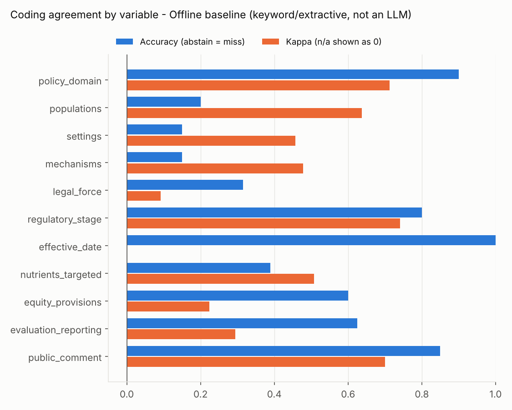
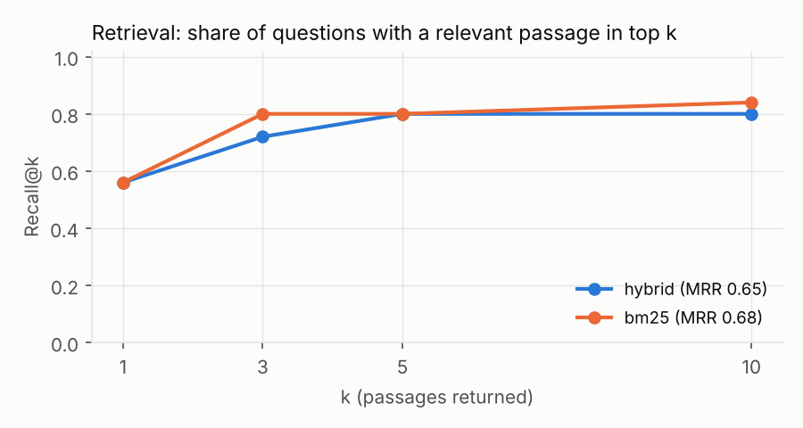

# Evaluation results

_Generated 2026-11-05T05:31:36+00:00 by `make eval`. Do not edit by hand._

> **These numbers come from the offline keyword/extractive baseline, not from an LLM.** They show that the evaluation pipeline runs end to end and set a floor a real model must beat. To evaluate Claude, run `python -m policylab.evaluation --provider anthropic` with `ANTHROPIC_API_KEY` set.
>
> **The gold standard is not validated.** 0 of 20 gold documents have been verified by a human coder; metrics below use the assistant-drafted starter labels (`status = draft_unverified`). Treat every agreement number as a pipeline smoke test, not a finding. See `docs/evaluation_protocol.md`.

## Run configuration

| Item | Value |
|---|---|
| Coding/Q&A provider | Offline baseline (keyword/extractive, not an LLM) (`extractive-keyword-baseline-v1`) |
| Live LLM | no |
| Prompt versions | coding `coding_v1`, Q&A `qa_v1` |
| Codebook version | 1.0.0 |
| Gold tier used | `draft_unverified` (213 cells, 20 documents) |
| Gold status counts | draft_unverified: 213, todo: 7 |
| Corpus | 61 documents, 5094 chunks |

## 1. Policy coding: AI vs. human agreement

Macro accuracy **54%**, macro kappa **0.48**, supporting quotes found verbatim in the cited chunk: **100%**.

| Variable | n | Abstained | Accuracy | Accuracy when coded | Kappa | Kappa type |
|---|---:|---:|---:|---:|---:|---|
| policy_domain | 20 | 0% | 90% | 90% | 0.71 | Cohen's kappa |
| populations | 20 | 30% | 20% | 29% | 0.64 | mean per-label binary kappa |
| settings | 20 | 20% | 15% | 19% | 0.46 | mean per-label binary kappa |
| mechanisms | 20 | 10% | 15% | 17% | 0.48 | mean per-label binary kappa |
| legal_force | 19 | 0% | 32% | 32% | 0.09 | Cohen's kappa |
| regulatory_stage | 20 | 0% | 80% | 80% | 0.74 | Cohen's kappa |
| effective_date | 20 | 0% | 100% | 100% | n/a | n/a (dates: exact-match accuracy only) |
| nutrients_targeted | 18 | 0% | 39% | 39% | 0.51 | mean per-label binary kappa |
| equity_provisions | 20 | 0% | 60% | 60% | 0.22 | Cohen's kappa |
| evaluation_reporting | 16 | 0% | 62% | 62% | 0.29 | Cohen's kappa |
| public_comment | 20 | 0% | 85% | 85% | 0.70 | Cohen's kappa |

Accuracy counts an abstention as a miss. Multi-select variables count as correct only on an exact set match; kappa for them is the mean of per-label binary kappas. With ~20 documents, kappa confidence intervals are wide (roughly +/-0.2 or more); do not over-read small differences.

## 2. Grounded Q&A

| Metric | Value |
|---|---:|
| Questions | 18 |
| Abstention rate (all questions) | 33% |
| Correct abstention (unanswerable questions) | 100% |
| False abstention (answerable questions) | 0% |
| Key facts present in answer (answerable) | 50% |
| Citation precision (cited chunk supports the sentence) | 100% |

Citation precision is measured by the lexical verifier in `policylab/verify.py` (content-word overlap >= 0.6 and every number in the sentence present in the chunk). An extractive baseline scores near 100% by construction because it copies sentences; the metric is meaningful for a generative model.

## 3. Retrieval

| Retriever | Recall@1 | Recall@3 | Recall@5 | Recall@10 | MRR@10 |
|---|---:|---:|---:|---:|---:|
| hybrid | 56% | 72% | 80% | 80% | 0.65 |
| bm25 | 56% | 80% | 80% | 84% | 0.68 |

25 question-passage pairs (status: `draft_unverified`), searched over the full corpus without filters.

## 4. Time saved

Status: **placeholder - not measured**. Time manual coding of the gold documents; log review time in the app (seconds_spent is stored per review decision); fill eval/time_assumptions.yaml.

## What is real and what is placeholder

| Component | Status |
|---|---|
| Corpus, chunk IDs, retrieval index | Real (Federal Register API + GovInfo text) |
| Retrieval metrics | Real computation; question set is an unverified draft |
| Coding metrics | Real computation; gold labels are `draft_unverified` |
| Model under test | Offline baseline (not an LLM) |
| Time saved | Placeholder until timed |
